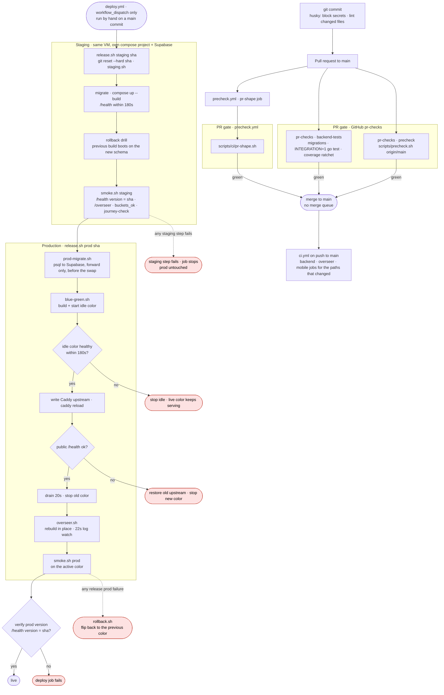
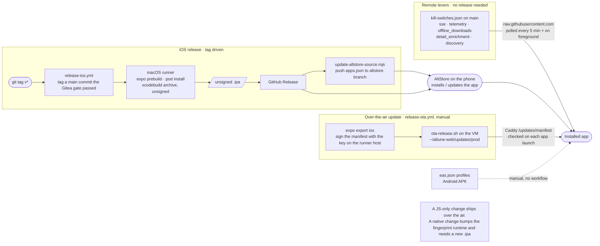

# Delivery

## Backend deploy

From commit to live: PR precheck, merge, then a deploy someone starts by hand. Nothing deploys on merge. Red boxes are the automatic fallbacks.

## Mobile release

How an iOS build reaches phones, and what can change without a new build.

