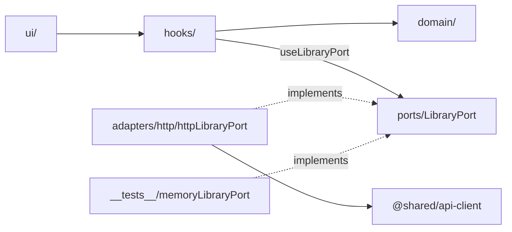

# Frontend ports: library feature behind a port

## Outcome

Feature logic in `apps/mobile` stops importing HTTP calls directly. Each feature reaches the API through a port (an interface it owns), with an HTTP adapter for the app and an in-memory fake for tests. Pure rules live apart from React glue. Who has the problem: the developer (and the agents) changing features. Today 159 feature files import `@shared/api-client`, tests stub it with `jest.mock`, and a runtime bug in one api-client call (#1123, `signal.throwIfAborted` missing on Hermes) reached prod behind mocks. Done, to them: a feature's tests run on a fake port with no `jest.mock`, the lint stops a new direct import, and `features/library` is the folder layout the other features copy.

## Appetite

7 tickets, 4 waves. Cap 8, each about an hour of build.

## Scope

### In

- `features/library/ports/libraryPort.ts` (new): the `LibraryPort` interface, one method per network call library makes today: `getTracks`, `getAllTracks`, `getLibraryAlbums`, `getLibraryArtists`, `listTracksFeaturing`, `getPlaylist`, `getPlaylists`, `searchDiscovery`, `deleteTrack`, `reacquireTrack`. Signatures copy the api-client functions exactly (`shared/api-client/tracks.ts:130,154,186,194,230`, `library.ts:98,110`, `playlists.ts:94,106`, `discovery.ts:258`), so the adapter is plain delegation and no behaviour changes.
- `features/library/adapters/http/httpLibraryPort.ts` (new): `export const httpLibraryPort: LibraryPort`, delegating each method to the api-client function. The only library file allowed to import api-client values that make network calls.
- `features/library/ports/LibraryPortProvider.tsx` (new): a React context whose default value is `httpLibraryPort`, plus `useLibraryPort(): LibraryPort`. The app needs no wiring. Tests wrap a hook in `<LibraryPortProvider port={fake}>`.
- `features/library/__tests__/memoryLibraryPort.ts` (new): `createMemoryLibraryPort(seed)`, mirroring `shared/navigation/__tests__/memoryNavigator.ts:3`.
- `features/library/__tests__/libraryPortContract.test.ts` (new): one `describe.each` over the memory fake and `httpLibraryPort` driven through the existing fake fetch (`jest/doubles/fetch.js:105`), mirroring `shared/navigation/__tests__/navigatorContract.test.ts:39-41`.
- Move the 10 hooks with network imports onto `useLibraryPort()`: 8 query hooks (`useLibraryTracks`, `useLibraryIsEmpty`, `useLibraryAlbums`, `useLibraryArtists`, `useTracksFeaturing`, `usePlaylistActions`, `usePlaylistDetail`, `useExploreArtist`), 2 mutation hooks (`useDeleteTracks`, `useReacquireTrack`). `useRetryAcquisition.ts:4-9`, `useReacquireTrack.ts:6` and `PlaylistDetailScreen.tsx:5` also import pure helpers from `api-client/ids` and `api-client/trackAcquisition`, which stay allowed.
- Plain functions that fetch take the port as their first argument, because `useLibraryPort()` only works inside a render: the pending poll in `useLibraryTracks.ts:56-118` (the port rides in the existing `PollTarget` object at `:50-54` and joins the effect deps at `:115-118`), `searchTopMatch` / `openTopMatch` in `useExploreArtist.ts:32-51`, `reacquireOptions` in `useReacquireTrack.ts:36-42`, and `deleteOne` in `useDeleteTracks.ts:54-56` (used by `deleteTrackForBulk` at `:58-60`, and by `useDeleteTrack.ts:72`, which becomes `mutationFn: (id) => deleteOne(port, id)`). `deleteOne(port, id)` changes one call in `useDeleteTracks.test.tsx:513`, a test-amend.
- Both ports are object literals of arrow functions, never classes, since `usePagedGroupQuery.ts:26-29,64` calls `fetchPage` unbound. The adapter delegates with arrows (`(...a) => tracks.getTracks(...a)`) so a future `jest.spyOn` still works.
- MC-2 (`eslint/consistency/mc-2-owning-hook.js`, owners at `:15,:18`): the import owner of `deleteTrack` and `reacquireTrack` becomes `httpLibraryPort.ts`. The owning *hook* rule moves to the port method: only `useDeleteTracks.ts` calls `port.deleteTrack`, only `useReacquireTrack.ts` calls `port.reacquireTrack`. The MC-2 row in `docs/conventions/mobile-consistency.md:11` is updated to match.
- New rule MC-8 `eslint/consistency/mc-8-feature-ports.js` (auto-loaded by `eslint/consistency/index.js:4-9`): no value import from `@shared/api-client` in any form (alias, barrel, relative path) outside `src/features/*/adapters/**`. Scoped with `ignores` only (`src/shared/**`, `src/app/**`, `src/app-shell/**`, adapters), never `files`, because the ratchet test lints its examples as a root `MC-8.tsx` (`scripts/__tests__/consistency-ratchet.test.ts:14,40-54`). `import type` is allowed, and so are the pure modules `ids`, `trackAcquisition`, `types`, `wireDecoders`. Baseline is exact: 42 today, 10 of them library, so 32 after the slice (`consistency-ratchet.mjs:73` needs an exact match, one hit per import statement). The ratchet runs in `scripts/precheck.sh:176` and in CI jest (`consistency-ratchet.test.ts:66-73`). The MC-8 row goes into `docs/conventions/mobile-consistency.md`, and the doc check at `consistency-ratchet.test.ts:56-63` gains MC-8 (test-amend).
- Inner layers for library: the 8 truly pure root files move to `domain/`: `sort`, `state`, `refresh` (one ticket, 30 importing files, including `failureLogFields.ts:3`, `activeView.ts:3` and `libraryFailureAlert.ts:3`), then `groupPaging`, `failureLogFields`, `goBackOrToLibrary`, `featuringDetailRoute`, `library-to-discovery` (a second ticket, 19 importing files, plus the `jest.mock('../groupPaging')` paths in `useAlbumsView.test.tsx:20`, `useArtistsView.test.tsx:20`, `usePlaylistsView.test.tsx:41`, a test-amend). Pure means no value import from `react`, `react-native`, `expo-*`, `lucide-react-native`, the `@shared/ui` barrel, `./hooks`, `./ui` or `./adapters`. Both are labelled `mechanical`: move and fix imports, nothing else. No file outside library imports any of them. Purity is enforced by the boundary test (must-hold 5), not by an ESLint block, because a new `no-restricted-imports` block would replace the platform-free rule's options at `eslint.config.js:89-122` (flat config, last block wins).
- `docs/conventions/feature-layers.md` (new): the layout (`domain/`, `ports/`, `adapters/http/`, `hooks/`, `ui/`) and the recipe for moving the next feature onto a port.

### Out

- Rewriting existing library tests from `jest.mock('@shared/api-client/...')` onto the fake: those tests still pass, because `jest.mock` intercepts the module the adapter imports. Rewriting them is test-amend work for each file, and goes to the backlog.
- Other features (detail, discover, settings, playback, auth) and the shared modules (playlists, favorites, acquisition, offline): each is its own slice on the library template.
- Frontend domain types separate from wire types: decided in step 3, `import type` stays allowed.
- `shared/playback` vs `features/playback`: already a port (contract) and adapters (engines), `.fallowrc.json:99`.
- A monorepo split into shared/native/web apps: web is the Expo web export of the same app (`.gitea/workflows/deploy-web.yml`), so a split pays nothing.
- Jest runtime parity for `AbortController` plus a lint ban on APIs Hermes lacks: its own ticket outside this epic (decided in step 3).

## Pre-mortem

1. It failed because the port changed behaviour: a hook passed its arguments in a different order or dropped the `signal`, and cancellation or paging broke on the device.
2. It failed because the lint rule had a hole: a feature imported api-client through `@shared/api-client` (the barrel `index.ts`) or a relative path, and MC-8 counted none of it.
3. It failed because the domain move broke importers outside the feature: `app-shell` or `app/` routes imported a moved file, and the web build failed after merge.

## Risks

- **Behaviour drift (pre-mortem 1).** The port copies the api-client signatures exactly, and the adapter is plain delegation, with no logic. The existing hook tests stay unchanged and must pass, which pins behaviour: they mock the api-client module the adapter calls. The contract test runs the real adapter over the fake fetch, so the `signal` and query string reach the request.
- **Lint hole (pre-mortem 2).** MC-8 matches `@shared/api-client`, `@shared/api-client/*`, and relative paths that end in `shared/api-client/...`. The rule has its own test cases for the barrel and a relative path.
- **Outside importers (pre-mortem 3).** Only `ui/` and `hooks/` files are imported from outside library (`app/(tabs)/library/*`, `app/(tabs)/discover/featuring.tsx`, `app-shell/wideChrome.tsx:4`, `app-shell/platformExtras.web.tsx:4`). The domain move touches none of them. The move ticket runs `tsc --noEmit` and the web export build in its Verify.
- **MC-2 weakened.** Moving the import owner to the adapter could let any library hook call `port.deleteTrack`. Kept safe by a must-hold test that only the owning hook calls each mutating port method.
- **Width of the move.** The 8 files have about 58 importers. Split into 2 `mechanical` tickets, the second depending on the first so they never edit the same importer at once.
- **Fallow may flag `LibraryPortProvider` as unused**, since only tests use it and fallow skips tests (`.fallowrc.json:10-11,42`). If it does, the tracer mounts `<LibraryPortProvider port={httpLibraryPort}>` once around the library routes.

## Build

Extends `features/library` and `eslint/consistency`, no new infra, no new dependency. Mirrors the Navigator port (`shared/navigation/navigator.ts:3-8`, `expoRouterNavigator.ts:5-7`, `__tests__/memoryNavigator.ts:3`, `__tests__/navigatorContract.test.ts:39-41`).

Platforms: ios, android, web (no UI change. The same hooks run on all three).

Decision, injection by React context with the HTTP adapter as default. Rejected: a module slot like `createFileStoreSlot` (`shared/files/fileStore.ts:88-101`), because a mutable global leaks a fake between tests, and the slot exists for non-React modules. Rejected: a port passed as a hook parameter, because every screen would then thread it through.

Decision, the port is per feature (`LibraryPort`), not per api-client module. Library owns the shape it needs. Other features get their own port, which may share the HTTP functions.

No state transition or lane event is added. MC-8 is enforced by `scripts/consistency-ratchet.mjs` (precheck and CI jest). `domain/` purity is enforced by `features/library/__tests__/libraryPortBoundary.test.ts` in CI jest.

Waves: 1) tracer: port, adapter, provider, fake, contract test, `useLibraryTracks` moved, must-hold tests planted. 2) three tickets in parallel with disjoint files: the other query hooks, playlist and discovery hooks, mutation hooks plus MC-2. 3) MC-8 plus the docs, and domain move part 1. 4) domain move part 2.

## First slice

A developer opens `features/library/hooks/__tests__/useLibraryTracks.test.tsx`, wraps the hook in `<LibraryPortProvider port={createMemoryLibraryPort({ tracks })}>`, and the test runs with no `jest.mock`. The app itself is unchanged: the library screen loads, pages and deletes as before on iOS, Android and web.

## Backlog

- Library still reaches the network through shared modules, around the port: `@shared/playlists` (`usePlaylistActions.ts:8`, `usePlaylistRename.ts:4`, `usePlaylistDelete.ts:3`, `usePlaylistTrackRemoval.ts:5`, `PlaylistAddTracks.tsx:3`, `LibraryScreen.tsx:13`, `TrackSelectionOverlay.tsx:5`) and `@shared/acquisition` (`useRetryAcquisition.ts:17`). Waits for the shared-modules slice.
- The 7 impure root files (`activeView`, `gridColumns`, `libraryFailureAlert`, `pinBatchSummary`, `pinnedStatusDisplay`, `selectionActions`, `trackMenu`): each needs its pure part split from its UI part before it can move. Judgment work, not a move.
- 6 feature imports take harmless values from the api-client barrel (`ApiError`, `NetworkError`, `isRetryable`, `REQUEST_TIMEOUT_MS`, `apiBase`). Importing them from `@shared/errors` lowers the MC-8 baseline by 4.
- Rewrite the ~17 library test files that `jest.mock` the api-client onto the memory fake: needs test-amend per file, and the slice proves the pattern first.
- Detail feature on a port (49 importers, 13 runtime): the biggest, and copies the library template once it exists.
- Discover feature on a port (26 / 4): small, the next good slice.
- Settings (8 / 5), auth (2 / 2), playback feature (13 / 9) on ports: the playback engines already sit behind a contract, so only their api-client calls need it.
- Shared modules on ports: playlists, favorites, acquisition, offline (4 / 4 runtime). These hold the shared hooks that features call.
- Frontend domain types apart from wire types (`TrackResponse` in 49 library files): only pays once features stop changing with the API.
- Inner layering (`domain/`, `ports/`, `adapters/`) for the other features, one per feature slice.
- Close epic #114 as done: every port it named exists. Only `useCurrentSegments` and fakes for dialog and keyboard are missing, and those can move to this backlog.

## Must-holds

1. Library code outside `adapters/` imports no api-client value that is not allow-listed. [repo-test: apps/mobile/src/features/library/__tests__/libraryPortBoundary.test.ts]
   - Example: `import { getTracks } from '@shared/api-client/tracks'` in `hooks/useLibraryIsEmpty.ts` → the test fails and names that file. `import type { TrackResponse } from '@shared/api-client/types'` → passes.
2. The memory fake and the HTTP adapter pass the same contract. [repo-test: apps/mobile/src/features/library/__tests__/libraryPortContract.test.ts]
   - Example: `getAllTracks({})` with 450 seeded tracks → both return 450 items with `truncated: false`. An aborted `signal` → both reject with `name === 'AbortError'`.
3. A library hook runs on the memory fake with no `jest.mock`. [repo-test: apps/mobile/src/features/library/__tests__/useLibraryTracks.test.tsx]
   - Example: a fake seeded with 3 tracks inside `LibraryPortProvider` → `useLibraryTracks` returns those 3 track ids.
4. Only the owning hook calls each mutating port method. [repo-test: apps/mobile/src/features/library/__tests__/libraryPortBoundary.test.ts]
   - Example: a `port.deleteTrack(` call in `hooks/useTrackMenu.ts` → the test fails. The same call in `hooks/useDeleteTracks.ts` → passes.
5. Files in `features/library/domain/` make no value import from React, React Native, Expo, `lucide-react-native`, the `@shared/ui` barrel, `./hooks`, `./ui` or `./adapters`. [repo-test: apps/mobile/src/features/library/__tests__/libraryPortBoundary.test.ts]
   - Example: `import type { ReactElement } from 'react'` in `domain/sort.ts` → the test fails and names the file.
6. The MC-8 count matches its baseline exactly, and the baseline only goes down. [repo-test: apps/mobile/scripts/__tests__/consistency-ratchet.test.ts]
   - Example: a new `import { getTracks } from '@shared/api-client'` in `features/discover/hooks/x.ts` → the ratchet prints `MC-8: <baseline+1> / baseline <baseline>` and exits 1.

## Expected signals

No endpoint and no page changes. Every API request the app sends stays byte-for-byte the same (same paths, query strings, methods). Telemetry stays flat: `library.*` mutation action ids keep firing at today's rate, and `failure_shown` for library does not rise after release.

## Decisions

- Only network calls go behind the port. `import type` from api-client stays allowed (user, step 3).
- Library gets `domain/`, `ports/`, `adapters/http/`, `hooks/`, `ui/` in this slice, as the template (user, step 3).
- The jest `AbortController` parity fix plus the runtime-API lint ban is its own ticket, outside this epic, filed now (user, step 3).
- Default: injection by React context with the HTTP adapter as default value.
- Default: one port per feature, signatures copied from api-client.
- Default: existing library tests are not rewritten in this slice. One call in `useDeleteTracks.test.tsx:513` and the ratchet doc check change (test-amend).
- Default: a plain function that fetches takes the port as its first argument.
- Default: only the 8 pure root files move to `domain/` in this slice. The 7 impure ones wait in the backlog.
