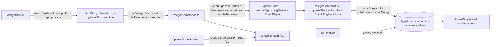

# Altune iOS widget — now playing (slice 1)

## Outcome

Altune users, mostly on iPhone and listening in the car, want to see and control playback without opening the app. Done looks like: they add an Altune widget to the home screen, it shows the current track (cover, title, artist) and live play state, and the buttons work — play/pause, next, previous, shuffle, repeat — driving the real player. It is sideloaded with a free Apple ID through SideStore/AltStore, so no paid account and no entitlements. The same small widget is what shows on the iOS 26 CarPlay dashboard. The full outcome also covers lock-screen widgets, a Control Center / Action Button control, a large widget with Up Next, and a configurable playlist set; those are the backlog.

## Appetite

8 tickets, 3 waves. Each about an hour of build. A slice over it is cut, never the appetite raised.

## Scope

### In

- **Replace the spike.** Delete the tap-counter `client/targets/carplay-widget/` (PR #2395, shipped v2.1.2) and add the real widget at `client/targets/widget/`. `@bacons/apple-targets` is already wired (`client/app.json` plugins, `client/package.json`).
- **App Group, declared for sideload AND resolved at runtime (safety-critical).** Two halves:
  - *Declare it so SideStore provisions it.* Add `group.com.altune.app` to `ios.entitlements` (prebuild writes it to both the app and the appex via @bacons/apple-targets `appGroupsByDefault`), AND add `ALTAppGroups: ["group.com.altune.app"]` to `ios.infoPlist` in `app.json`. The unsigned archive ships no entitlement blob (`release-ios-build.sh` uses `CODE_SIGNING_ALLOWED=NO`), so SideStore/AltStore decide which group to register from `ALTAppGroups` in Info.plist. Without this key the re-signed build has no provisioned group and both bundles fall through to an unshared store. This closes the top pre-mortem.
  - *Resolve the real name at runtime.* SideStore/AltStore rename the provisioned group to `group.com.altune.app.<teamID>`. A shared Swift helper `targets/_shared/AppGroup.swift` resolves it: parse the bundle's `embedded.mobileprovision` (plist → `Entitlements` → `com.apple.security.application-groups`, take the `group.com.altune.app` prefix), fall back to `ALTAppGroups` in Info.plist, fall back to the hard-coded id. Both the app module and the widget use this one helper.
- **Shared Swift in `targets/_shared/`** (the GLOBAL shared folder, which @bacons/apple-targets links into both the app target and the widget extension; the per-target `targets/widget/_shared/` only reliably reaches one target). Files: `AppGroup.swift` (above), `AltuneIntents.swift` (one `AudioPlaybackIntent` each for play/pause, next, previous, shuffle, repeat), and `IntentBridge.swift` — a stub holding `static var handler: ((String) -> Void)?` defaulting to nil. Each intent's `perform()` calls `IntentBridge.handler?(command)`. The app's local Expo module SETS that handler at launch; in the widget target it stays nil (the intent only ever runs in the app process, per Apple). Putting the stub in `_shared` means both targets link with no app-only symbol.
- **Local Expo module** `client/modules/altune-widget/` (the client has none today; this is the first — ticket 1 verifies it autolinks under Expo 57 CNG and compiles in the unsigned archive). It (a) sets `IntentBridge.handler` to emit `onWidgetCommand` events to JS; (b) buffers commands received before JS subscribes and drains them in order on subscribe; (c) exposes `writeSnapshot(json)`, `writeCover(localUri)` and `reloadWidget()` to JS, all writing to the runtime-resolved group container and calling `WidgetCenter.shared.reloadAllTimelines()`.
- **Headless sign-in prime (safety-critical for cold launch).** The signed-in gate `whenSignedIn` (`playbackService.ts:88`) reads a flag set only by the React `useSession` hook (`useSession.ts:48` → `notifyIdentityChange`, `signOutCleanup.ts:38`). When a widget intent cold-launches the app, that hook may not have resolved, so every command would be silently swallowed. Fix (same as the Android-Auto plan): a three-state flag (unknown/in/out) in `signOutCleanup.ts`, primed by a new `primeSignedInUser` bound at service boot (inside `playbackService()`) that reads the stored Supabase session (`supabase.auth.getSession()`, `supabaseClient.ts:26`), writes only from unknown, re-checks the session epoch after the await, and never fires identity listeners. Without this, must-hold 7 fails.
- **JS command handler** in `client/src/features/playback/native/widgetCommands.ts`, registered from `registerPlaybackService` (`playbackService.ts:234`), subscribing to `onWidgetCommand`. Each command maps to the same path the remote handlers use (`playbackService.ts:184-231`), wrapped in `whenSignedIn` and `reportingRemoteCommand`/`reportingQueueFailure`: play→`TrackPlayer.play`, pause→`TrackPlayer.pause`, next→`withNativeQueue(skipToNext)`, previous→`playPreviousRemotely` (today a module-private `async function` at `playbackService.ts:170` — EXPORT it or co-locate the handler), shuffle→`reorderUpcomingNative(useQueueStore.getState().toggleShuffle())` (the native reorder at `src/features/playback/native/rebuildNativeTail.ts:56` takes `toggleShuffle`'s returned upcoming list and acquires `withNativeQueue` itself; the hook's `reorderUpcoming` is React-context-bound and unreachable headless), repeat→`useQueueStore.getState().cycleRepeatMode()` then re-read `getState().repeatMode` and call `TrackPlayer.setRepeatMode` with the off→Off/all→Queue/one→Track map (replicated from `src/features/playback/native/TrackPlayerPlaybackProvider.tsx:24-28`, which is not exported; the store alone does not reach the native player).
- **Snapshot publisher** `client/src/features/playback/native/widgetSnapshot.ts`, registered from `registerPlaybackService`: combine `useQueueStore.subscribe` (title, artist, artworkUrl from `currentTrack()` at `shared/playback/queueStore.ts:271`; `shuffled`, `repeatMode`, and the playlist name from `useQueueStore.getState().source` — the top-level `QueueState.source`, NOT `PlaybackTrack.source` which is a different `{kind}` field) with a new `TrackPlayer.addEventListener(Event.PlaybackState)` for isPlaying (nothing listens to it today; RNTP allows multiple listeners, so no conflict with the provider's `usePlaybackState` hook). On any change, write a JSON snapshot and, when the artwork URL changes, download + downscale the cover to ~300px and write it to the group container (widgets can't load remote images), then `reloadWidget()`. Debounce writes (coalesce bursts within ~500ms).
- **Sign-out clears it.** `onSignOut` (`signOutCleanup.ts:22`, as `playbackService.ts:236` already does) writes an empty snapshot → the widget shows the signed-out state.
- **Widget UI** in `targets/widget/AltuneWidget.swift`: systemSmall (cover-fill + bottom scrim, title/artist, prev/play/next) and systemMedium (full-bleed cover, title/artist/source, display-only progress bar, 5 controls), per `docs/drafts/ios-widget/mockup/choice.md`. Reads the snapshot + cover file from the resolved group container. TimelineProvider shows the last snapshot; policy `.never` (JS drives reloads). Signed-out and nothing-played states per the mockup empties. Progress bar is display-only (position from the snapshot; no live ticking needed for the slice).
- **Ship.** Run the existing iOS release (`.github/workflows/release-ios.yml`) for a new version so the user sideloads and tests on iPhone + CarPlay.

### Out

- Large widget + Up Next — a different, denser surface; backlog.
- The 3 lock-screen accessory widgets and the iOS 18 Control Center / Action Button control — separate widget families/extensions; backlog.
- Configurable-playlists edit sheet and on-device 4-recent-playlist tracking — only the large widget shows playlists, which is itself out; backlog.
- CarPlay full app, Android Auto — different outcomes; Android Auto parked at `docs/drafts/android-auto/plan.md`.

## Pre-mortem

- It failed because the widget showed stale or blank data: the App Group didn't resolve under SideStore, so app and widget wrote to different stores and neither saw the other.
- It failed because a button did nothing when the app was closed: the signed-in flag was never primed headless, so `whenSignedIn` swallowed every command; or the command arrived before the player was set up.
- It failed because adding `ios.entitlements` / an App Group broke the unsigned archive build or the sideload re-sign, so the whole app stopped installing.

## Risks

- **App Group under sideload re-signing (kept in scope, safety-critical).** Answer: the runtime resolver (parse profile → `ALTAppGroups` → fallback) used by both bundles, with must-hold 2. A dev build (hard-coded group matches) and a sideloaded build (renamed group) both resolve to the same shared store.
- **Entitlements change breaks the build/install (kept in scope).** Adding `ios.entitlements` + `ALTAppGroups` means the unsigned archive (`release-ios-build.sh`, `CODE_SIGNING_ALLOWED=NO`) must still produce an installable `.ipa`, and SideStore must still re-sign it and provision the group from `ALTAppGroups`. Answer: ticket 1 adds the App Group + entitlement + `ALTAppGroups` alone and ships a build the user installs before any widget logic lands; must-hold 6 + the operator install check. Rollback is reverting that ticket.
- **Cold-launch sign-in (kept in scope, safety-critical).** Without the headless prime the widget buttons are dead when the app is closed. Answer: `primeSignedInUser` in scope, must-hold 7 proves buttons work app-closed.
- **Shared Swift must link into both targets.** Answer: use the global `targets/_shared/` folder (not per-target), with the `IntentBridge` stub there so the widget links without the app-only module; ticket 1's prebuild + must-hold 1 confirm the appex embeds.
- **Headless command before player ready.** Answer: the Expo module buffers commands until JS subscribes; the JS handler goes through `whenSignedIn` and the same `ensurePlayerSetup`/`reportingQueueFailure` path as the lock-screen remote handlers, which already handle a cold player. Must-hold 3.
- **OTA runtime changes.** The native target + entitlement change the fingerprint runtime (`app.json` `runtimeVersion.policy: fingerprint`), so installed apps need the new build, not an OTA. The release ships a new `.ipa`; the user reinstalls. (Same as every native change.)
- Cold-launch latency and stale cover file: answered by must-holds 3 and 4.

## Build

Platforms: ios (home-screen widget + its CarPlay-dashboard appearance). No web/android surface.

New boundary (the app↔widget bridge), decided:
- **Local Expo module + global `targets/_shared/` Swift (intents + IntentBridge stub + AppGroup) + App Group declared via `ALTAppGroups` and resolved at runtime (chosen).** Boring: App Group + UserDefaults + WidgetCenter is Apple's standard widget data path; the non-standard parts — declaring `ALTAppGroups` so SideStore provisions the group, and resolving the renamed group at runtime — are both forced by sideload re-signing.
- Rejected: `@bacons/apple-targets` `ExtensionStorage` for the data path. It takes the group id from JS and leans on expo-file-system's build-time group, which is the renamed-group trap; the runtime resolver is needed regardless.
- Rejected: `expo-app-intents`. Targets SDK 58, no widget/AudioPlaybackIntent support (earlier research).
- Rejected: calling RNTP/SwiftAudioEx directly from Swift. The player is private on the RN module instance; reaching it means patching the package.

Code owners of new events/transitions:
- `onWidgetCommand` (native→JS): fired by the local Expo module when an intent runs (`IntentBridge.handler`); handled only in `widgetCommands.ts`.
- Snapshot writes: fired by `queueStore.subscribe` + `Event.PlaybackState` in `widgetSnapshot.ts`; cleared by `onSignOut`.
- Signed-in flag: `notifyIdentityChange` (React, unchanged) and `primeSignedInUser` (service start, only when unknown).
- `widgetCommands`, `widgetSnapshot` and `primeSignedInUser` bind at service boot, inside the `playbackService()` body (`playbackService.ts:184`, where the existing remote listeners live), not the thin `registerPlaybackService` wrapper (:234).
- `primeSignedInUser` + the boolean→tri-state flag edit to `signOutCleanup.ts` is the SAME change the parked Android-Auto plan adds. Whichever slice builds first adds it; the other reuses it. Ticketize must not plant it twice.

## First slice

A user installs the new Altune build through SideStore, signs in, and plays something. They long-press the home screen, add the Altune widget (small or medium), and see the current track with cover, title, artist and the right play state. They tap play/pause, next, previous, shuffle and repeat on the widget and the music responds — even with the Altune app closed. The small widget is what appears on the iOS 26 CarPlay dashboard.

## Backlog

- Large widget + Up Next (2 upcoming tracks, tap to jump): denser surface; needs queue lookahead in the snapshot. `large.html` designed.
- 3 lock-screen accessory widgets (rectangular/circular/inline): monochrome vibrancy family; designed as `lock-*.html`.
- iOS 18 Control Center / Action Button control (Shuffle Library, Play/Pause): separate ControlWidget; designed as `control.html`.
- Configurable playlists + on-device 4-recent-playlist tracking: only the large/medium playlist surfaces need it; `config.html` designed.
- Live-ticking progress on the widget (vs the static snapshot position): a timeline-based refinement.
- CarPlay button behaviour confirmed on a real head unit or the CarPlay Simulator (the slice proves the dashboard appearance; interactive confirmation in-car is an operator check once hardware is available).

## Must-holds

1. The spike tap-counter is gone and the real widget builds in its place, with shared Swift in the global `targets/_shared/`. [repo-test: client/targets/widget/__tests__/widgetTarget.test.ts]
   - Example: `npx expo prebuild --platform ios` → no `carplay-widget` target, `AltuneWidget.appex` embedded, and `targets/_shared/{AppGroup,AltuneIntents,IntentBridge}.swift` present (IntentBridge a nil-default stub so the appex links).
2. The App Group resolves to the same id in the app and the widget, under both a dev build and a sideload-renamed profile, and `app.json` declares `ALTAppGroups` so SideStore provisions the group. [repo-test: client/targets/_shared/__tests__/appGroupResolve.test.ts]
   - Example: profile entitlements list `group.com.altune.app.ABCDE12345` → resolver returns that; no profile, Info.plist `ALTAppGroups=[group.com.altune.app.ABCDE12345]` → returns that; neither → returns `group.com.altune.app`. And `app.json` `ios.infoPlist.ALTAppGroups` contains `group.com.altune.app`.
3. Every widget command is ignored when signed out, and when signed in maps to the same player action as the matching remote handler; a cold-launched service primes the signed-in flag from the stored session. [repo-test: client/src/features/playback/native/__tests__/widgetCommands.test.ts]
   - Example: signed out, `onWidgetCommand('play')` → no `TrackPlayer.play` call. Signed in, `'repeat'` → `useQueueStore.getState().cycleRepeatMode()` then `TrackPlayer.setRepeatMode(RepeatMode.Queue)` for repeat "all" (store alone wouldn't reach native). Stored session present, no React → `primeSignedInUser` sets the flag so `'play'` reaches `TrackPlayer.play`.
4. A command received before JS subscribes is buffered and delivered once, in order, after subscribe. [repo-test: client/modules/altune-widget/__tests__/intentBuffer.test.ts]
   - Example: emit `next` then `pause` with no listener, then subscribe → listener gets `next`, `pause`, once each.
5. The snapshot the widget reads carries title, artist, isPlaying, shuffled and repeatMode, and sign-out writes the signed-out snapshot. [repo-test: client/src/features/playback/native/__tests__/widgetSnapshot.test.ts]
   - Example: queue current = "Midnight City"/"M83", playing, shuffle on, repeat all → snapshot `{title:"Midnight City",artist:"M83",isPlaying:true,shuffled:true,repeat:"all"}`. `onSignOut` → `{signedIn:false}`.
6. Normal playback and the app install are unchanged after the App Group + widget land. [operator: `cd client && npx tsc --noEmit`; run the iOS release workflow; sideload the `.ipa` via SideStore on a device; the app opens, signs in, and plays a track with lock-screen controls working]
   - Example: install the new build through SideStore → Altune launches, plays Playlist p1, lock-screen next works.
7. The widget shows live now-playing and its buttons drive playback with the app closed. [operator: add the small and medium Altune widget on an iPhone, force-stop Altune, tap play/pause/next/prev/shuffle/repeat on the widget]
   - Example: Altune force-stopped, play a track from the phone first, swipe home, widget shows "Midnight City"; tap next → track changes and the widget updates within a couple of seconds.

## Expected signals

- No API endpoints change. The widget reads only local shared state; playback uses the existing audio/track endpoints.
- New telemetry commands under the existing `reportingRemoteCommand`/`reportingQueueFailure`: `widgetPlay`, `widgetPause`, `widgetNext`, `widgetPrevious`, `widgetShuffle`, `widgetRepeat`. Their failure rate should match `remoteSkipNext` today.
- No pages change. APK/web unaffected (iOS-only target). iOS `.ipa` grows modestly from the widget extension; ticket 1 records the size.

## Decisions

- Build the home-screen now-playing widget (small + medium full-bleed) first; lock screen, large, Control Center, config to backlog (user, 2026-10-13: "start with bottom… lets actually get the widget ready to test").
- Everything stays free: free Apple ID, no entitlements beyond the App Group, SideStore install (user, throughout).
- Default: local Expo module + `_shared` Swift intents + runtime-resolved App Group, over ExtensionStorage / expo-app-intents / patching RNTP.
- Default: progress bar is display-only from the snapshot for the slice; live ticking is backlog.
- Default: the slice proves the CarPlay-dashboard appearance; interactive in-car confirmation is an operator check when hardware/Simulator is available.
- Default (from red-team round 1): declare `ALTAppGroups` in Info.plist so SideStore provisions the group; shared Swift lives in global `targets/_shared/` with an `IntentBridge` stub; prime the signed-in flag headless; shuffle uses `reorderUpcomingNative` and repeat replicates the native repeat map — all folded into Build.
